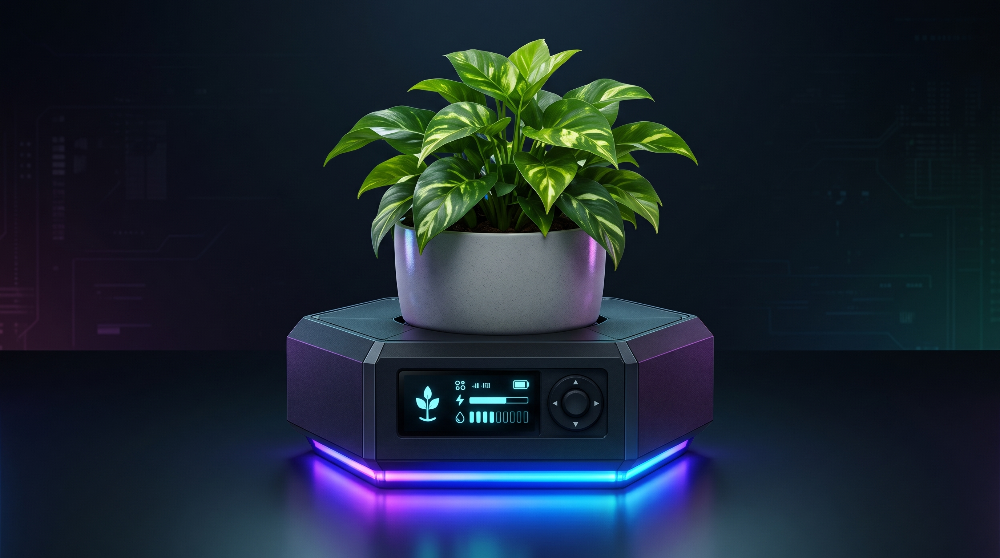

# RootHex: Smart Indoor Plant Base & Biophilic AR Ecosystem

<div align="center">
  
</div>

> **An AI-Driven Modular IoT Micro-Habitat, Multimodal Disease Clinic, Light-Validated AR Studio, and Gamified Care Platform.**

RootHex is an integrated IoT hardware and mobile software platform engineered to eliminate indoor plant mortality. Designed for both Plant Enthusiasts (B2C) and Interior Designers (B2B), it empowers users to style living spaces sustainably while ensuring optimal plant health through advanced telemetry and AI diagnostics.

---

##  The Problem We Solve
* **Blind Watering:** Timer-based systems ignore pot volume and species-specific needs. Over 40% of houseplants die in year one due to root rot or dehydration.
* **Visual Ambiguity in AI Diagnosis:** Camera-only apps often misdiagnose issues because overwatering, underwatering, and fungal blight share similar visual symptoms.
* **IoT Disengagement:** "Set-and-forget" automation causes users to stop checking on their plants.
* **Design Failures:** Plants are often placed in low-light corners for aesthetics, leading to rapid deterioration.

##  Core Ecosystem Pillars

### 1. Smart IoT Hardware Base
* **Compact Hexagonal Design:** Supports indoor pots up to 12 kg with a low 2.5 cm tabletop profile.
* **Mesh-Shielded Center Cone:** Anti-clog water delivery and capacitive soil moisture sensing directly into the root zone.
* **Closed-Loop Pulse-Drip Irrigation:** Pumps 20 ml micro-pulses every 15 minutes, waiting for capillary soak before re-reading moisture.
* **Collapsible Tactical Hydration Bladder:** Connects via a quick-release port to external bladders (500 ml - 2L+) hidden behind decor, solving internal volume limitations.
* **On-Device Interface:** Side OLED display, 4-way control joystick, and undercarriage RGB status glow ring.

### 2. Sensor-Fused AI Disease Clinic
* **Multimodal Fusion:** Cross-checks visual AI leaf scans against 14-day historical moisture and light telemetry logs to separate root rot from dehydration wilt.
* **Recovery Quests:** Assigns gamified 7-day recovery quests to nurse sick plants back to health.

### 3. Light-Validated AR Studio
* **Biophilic Design (B2B):** Allows interior designers to preview 3D pots in a client's space using AR.
* **Light Verification:** Verifies room sunlight before placement to guarantee long-term plant survival.

### 4. Gamified Care Platform
* **Proof-of-Care Collectibles:** Transforms daily upkeep into an engaging experience with evolving plant cards and hardware LED level-ups.
* **Community:** Reddit-style diagnostic threads for community support.

---

## 🛠️ Technical Specifications

### Hardware & Embedded Systems
* **Microcontroller:** ESP32 
* **Watering Mechanism:** Peristaltic micro-pump
* **Sensors:** Capacitive soil moisture sensor, optical photodiode (ambient light)
* **Enclosure:** 3-layer splash-proof enclosure with a compressed rubber waterproof gasket seal and spillway lip.

### Automated Plant Tier Calibration
FloraHex adapts to your plant's specific needs through three methods:
1. **AI Vision "Snap-to-Setup":** Photograph your plant in the app; the vision model identifies the species and flashes the exact moisture threshold to the base.
2. **Manual Hardware Toggle:** Use the standalone OLED and joystick to select presets (Succulent, Tropical, Fern).
3. **Pulse-Absorption Profiling:** The base measures the moisture jump delta over 10 minutes during the first watering to calculate pot size and scale future pulse volumes.

---

## Documentation Reference

For a complete breakdown of the architectural blueprint, mechanical engineering specifications, and early risk mitigation strategies, please refer to the primary project proposal document included in this repository:

 **FloraHex SDGP Project Proposal.pdf**

---

## 💻 Getting Started

*(Add instructions here once the codebase is uploaded)*


### Installation
1. Clone the repo:
   ```bash
   git clone https://github.com/yourusername/FloraHex.git
   ```
2. Navigate to the hardware directory and upload the sketch to the ESP32.
3. Navigate to the mobile app directory and run:
   ```bash
   npm install
   npm run start
   ```

---
